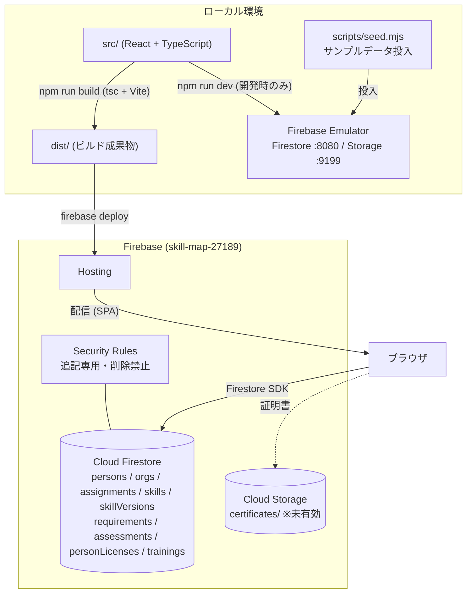
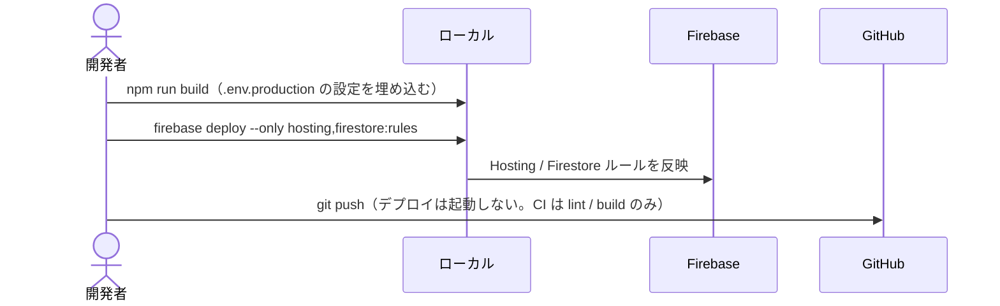

# スキルマップ

個人が持つ能力を「人」に紐づけて管理し、チームごとの適正人数に対する充足状況をマトリクスで確認するWebアプリ。
人財育成・配置管理システムの MVP（v0.9）。

## 公開URL

https://skill-map-27189.web.app

> **注意（v0.9）**: 認証は未実装で、このアプリのコレクションは認証なしで読み書きできます。サンプルデータのみを入れてください。実データを扱う前に認証と権限（後述）を実装します。
> Microsoft SSO・master-manager 連携を持つ旧版（v0.8）はタグ [`legacy-v0.8`](https://github.com/nishidaseibaku/skillmap/tree/legacy-v0.8) に残しています。

## 機能

- **チーム画面**: スキル × メンバーの力量マトリクス。セルを押して評価を登録。コアスキル充足率のカード（集計は `teamStats` に追加していく）
- **スキル管理**（チーム画面内）: スキル名クリックで編集、追加（新規／既存スキル）、チームから外す、適正人数、コア指定、ドラッグ＆ドロップ（↑↓キーも可）で並び替え
- **人財画面**: 現所属の達成状況、現所属外で保持しているスキル、評価履歴、所属履歴、異動、資格・免許、研修受講履歴、戻るボタン
- **評価は追記のみ**: 評価日・評価者・根拠を記録。スキルの内容（名称・基準・コア）は変更のたびに版を追記し、基準が変わった後の評価は破線の枠で「旧基準」を示す
- **異動しても能力は保持**: 旧所属で得たスキル・資格・研修は個人に残る。所属は履歴（終了日）で管理
- **資格・免許 / 研修受講履歴**: 有効期限の警告、証明書ファイル（Cloud Storage）。更新は新規追加、誤登録は「取り消す」（物理削除しない）

## 設計原則

- スキルの所有者は個人、所属は「現在地」として別管理
- チームが必要スキルと適正人数を持つ
- 評価・スキルの版は追記のみ（Firestore ルールで update/delete を禁止）
- 物理削除はしない（終了日・無効化で管理）
- 習得判定は全スキル共通でレベル3以上

## 技術スタック

| 区分 | 技術 |
|------|------|
| フロントエンド | React 18 + TypeScript + Vite |
| データ | Cloud Firestore（Security Rules で追記専用・削除禁止を強制） |
| ファイル | Cloud Storage（証明書。本番では未有効） |
| テスト | Vitest（集計・判定ロジック） |
| Lint | oxlint |
| ローカル開発 | Firebase Emulator Suite（Firestore / Storage） |
| ホスティング | Firebase Hosting |
| コード管理 | GitHub |
| CI | GitHub Actions（PR・ブランチで lint / build のみ。デプロイは行わない） |
| デプロイ | ローカルでビルドし、手元から `firebase deploy` |

## アーキテクチャ



## デプロイシーケンス



## セットアップ

前提: Node.js 20 以上、Java（エミュレーター用）、`firebase-tools`（グローバル）。

```bash
npm install
npm start      # エミュレーター起動 → サンプルデータ投入 → http://localhost:5173
```

個別に動かす場合: `npm run emulators` / `npm run seed`（データを全消去して再投入）/ `npm run dev`。
`npm run dev` は常にエミュレーターへ接続します（実プロジェクトには接続しません）。

テスト: `npm test`、Lint: `npm run lint`、型チェック: `npx tsc --noEmit`。

## デプロイ手順

```bash
npm run build
firebase deploy --only hosting,firestore:rules --project skill-map-27189
```

- 本番ビルドは `.env.production`（`VITE_FIREBASE_*`。公開前提のWeb設定のみで秘密情報は入れない）で接続します。
- `.firebaserc` の既定はエミュレーター用の `demo-skill-map` です。デプロイは必ず `--project` を指定します。
- 自動デプロイは行いません（v0.9.1 で GitHub Actions のデプロイ設定を削除）。push してもデプロイされないので、反映は必ず上記のコマンドで行います。
- 本番へのサンプルデータ投入: `SEED_TARGET=prod node scripts/seed.mjs`（追記のみ。投入先が空のときだけ実行）。
- Cloud Storage は本番では未有効のため、証明書のアップロードは使えません（証明書なしで登録できます）。
- 同じプロジェクトに旧版の Cloud Functions（`syncMasters`）と旧コレクション（`departments` / `members` / `teams` / `meta`）が残っています。このリポジトリのデプロイでは触りません。Firestore ルールは旧コレクションに許可を与えません。

## 今後（未実装）

認証（Microsoft サインイン、社内テナント限定）とロール別権限、資格マスタ・期限通知、教育計画、経営ダッシュボード、Excel移行、集計の Cloud Functions 化、適正人数の変更履歴。

## バージョン履歴

| 版 | 日付 | 内容 |
|----|------|------|
| v0.9.2 | 2026-10-30 | ファビコンを追加（`public/favicon.svg`。力量マトリクスを濃淡の 3×3 グリッドで表した SVG。ダークモード対応）。`index.html` に `theme-color` も設定 |
| v0.9.1 | 2026-10-30 | 自動デプロイ（`.github/workflows/deploy.yml`）を削除。デプロイはローカルでビルドして手元から行う運用に統一。CI（lint / build）は維持。CLAUDE.md のデプロイ手順を更新。コードの変更なし |
| v0.9 | 2026-10-30 | 人財育成・配置管理の MVP として0から再構築（React + TypeScript、Firestore エミュレーター開発）。チームの力量マトリクス、スキル管理（版管理・並び替え・コア指定）、評価の追記履歴、異動、資格・免許・研修受講履歴、コアスキル充足率カードを実装。旧版（Microsoft SSO・master-manager連携）は未実装のため `legacy-v0.8` に退避。認証なし・サンプルデータのみで暫定公開 |
| v0.8 | 2026-07-17 | master-manager 配信APIの大改定（全マスタ統一形式化）に対応してフロント・Functionsを0から再構築。社員取得を `/v1/masters/employees/items` に移行、チームマスタの `parentDeptCode` で部門↔チームを直接紐付け、マスタ同期を `syncMasters` Callable に集約（`legacy-v0.8`） |
| v0.7.2 | 2026-07-15 | 部門↔チームの分類を表示時に部門所属社員の teamCode から都度導出へ変更。「未分類」項目を廃止 |
| v0.7.1 | 2026-07-15 | 左サイドバーに「未所属メンバー」項目（件数バッジ付き）を追加 |
| v0.7 | 2026-07-15 | 左サイドバー構成に刷新。部門↔チームの親子関係を多数決で推定。マスタ同期を設定画面へ集約 |
| v0.6 | 2026-07-14 | UIをライトテーマに刷新、線画アイコンに統一 |
| v0.5 | 2026-07-10 | GitHub Actions による CI/CD を追加（Workload Identity Federation でキーレス認証） |
| v0.4.2 | 2026-07-10 | マスタを組織構成の唯一の正に統一 |
| v0.4.1 | 2026-07-10 | マスタ連携を実データ構造に整合、Cloud Functionsを本番デプロイ |
| v0.4 | 2026-07-10 | Microsoft SSO ログインと社員マスタ連携を追加、Firestoreルールを認証必須に強化 |
| v0.3.1 | 2026-07-01 | アーキテクチャ図のCLIツールをローカル環境ブロック内に移動 |
| v0.3 | 2026-07-01 | データ層を localStorage から Firestore に移行 |
| v0.2 | 2026-07-01 | Firebase Hosting へのデプロイ、GitHub リポジトリ公開 |
| v0.1 | 2026-07-01 | MVP 初回リリース（React + Vite + RPGスキルツリーUI） |
